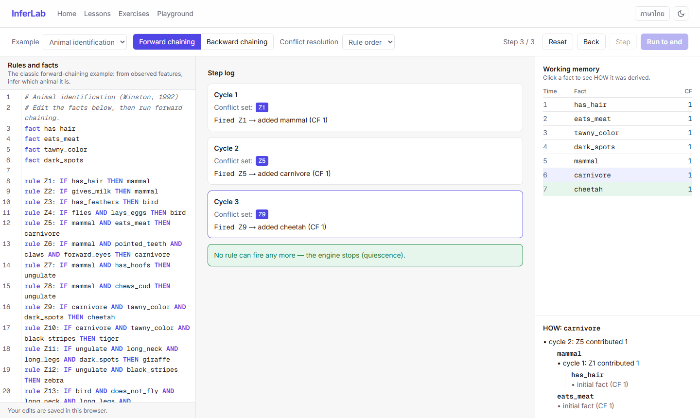
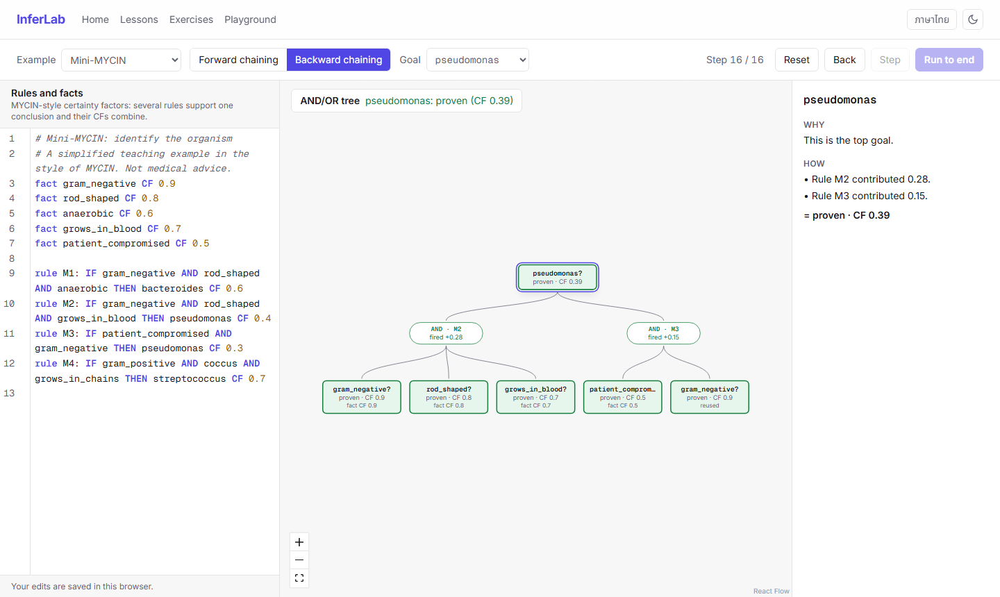
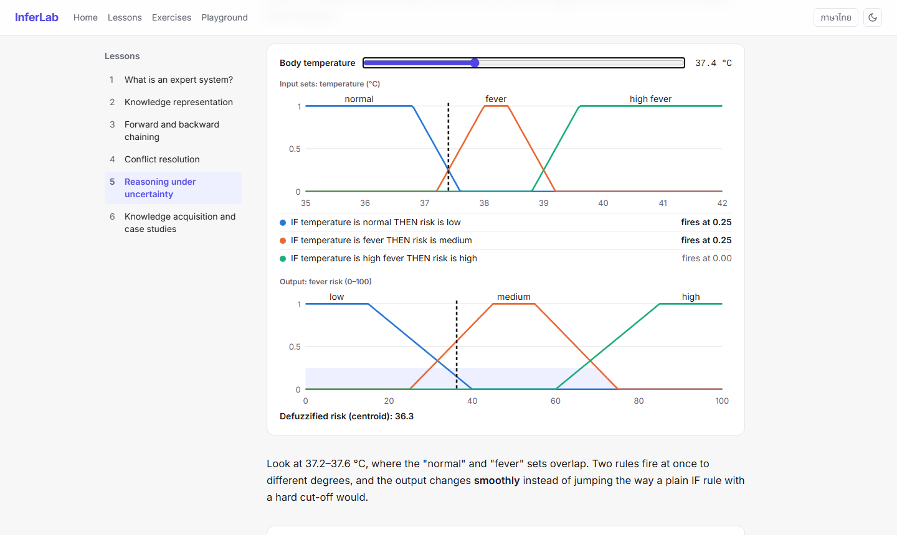
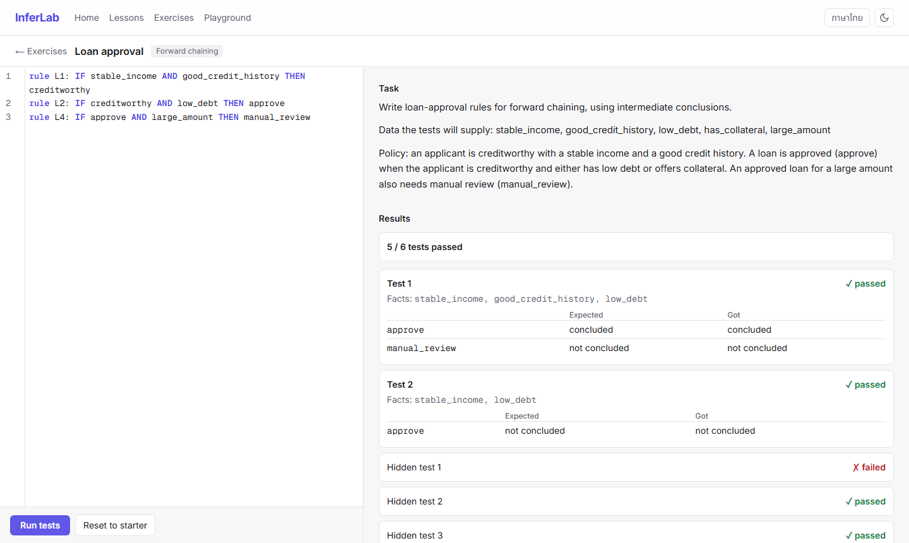

# InferLab

[](https://github.com/shibatj/inferlab/actions/workflows/ci.yml)

**🔗 Live: https://inferlab-th.vercel.app** (desktop browsers)

Interactive e-learning for **expert systems** (Thai / English). Write IF–THEN rules in a small language and watch an inference engine reason with them step by step.

- **Playground:** a rule editor with live error checking; step-by-step forward chaining (step log, working memory, HOW) and backward chaining (AND/OR tree, WHY/HOW); four conflict-resolution strategies; MYCIN certainty factors.
- **Six lessons** in Thai and English, with quizzes, including "predict the next rule" questions that the engine itself sets and marks. Widgets for fuzzy logic, semantic networks and frames.
- **Auto-graded exercises:** write rules until every test passes, including hidden tests.

The whole site is static and runs in the browser, with no backend. It is designed for desktop browsers.



| Backward chaining with certainty factors | Fuzzy-logic widget | Auto-graded exercise |
|---|---|---|
|  |  |  |

## Rule language

```
# Identify an animal
fact has_hair
fact eats_meat

rule Z1: IF has_hair THEN mammal
rule Z5: IF mammal AND eats_meat THEN carnivore CF 0.9 PRIORITY 1
```

`CF` (a number in [-1, 1]) and `PRIORITY` are optional.

## Tech

Next.js 16 (App Router; every route is prerendered as static HTML), TypeScript, Tailwind CSS 4, CodeMirror 6, React Flow and MDX. The inference engine in `src/engine/` is written from scratch, with no rule-engine library.

## Development

```bash
npm install
npm test           # unit tests (Vitest): engine, grader, lessons, playground logic
npm run typecheck
npm run lint
npm run dev        # http://localhost:3000 (redirects to /th)

npm run build
npx playwright install chromium   # once
npm run test:e2e   # end-to-end tests (Playwright) against the production build
```

CI (GitHub Actions) runs lint, typecheck, unit tests, build and E2E tests on every push and pull request. Vercel deploys `main` to production and every pull request to a preview URL. To run the E2E suite against a deployment: `E2E_BASE_URL=https://inferlab-th.vercel.app npm run test:e2e`.

## Docs

The how-it-works guides explain each part from first principles (Thai):

1. [Parser and forward chaining](docs/how-it-works/01-parser-and-forward-chaining.md)
2. [Certainty factors, conflict resolution and backward chaining](docs/how-it-works/02-backward-chaining-conflict-resolution-cf.md)
3. [Playground UI](docs/how-it-works/03-playground-ui.md)
4. [Lessons, quizzes and widgets](docs/how-it-works/04-lessons.md)
5. [Exercises and E2E tests](docs/how-it-works/05-exercises-and-e2e.md)

Design decisions are recorded in the [architecture decision records](docs/adr/).

## Roadmap

1. **M1** Parser and forward chaining, with tests ✅
2. **M2** Backward chaining, conflict-resolution strategies, certainty factors ✅
3. **M3** Playground UI: editor, step log, working memory, AND/OR tree, example knowledge bases ✅
4. **M4** Six bilingual lessons, quizzes, fuzzy/frames/semantic-net widgets ✅
5. **M5** Auto-graded exercises, E2E tests, production deploy on Vercel ✅

## License

[MIT](LICENSE)
